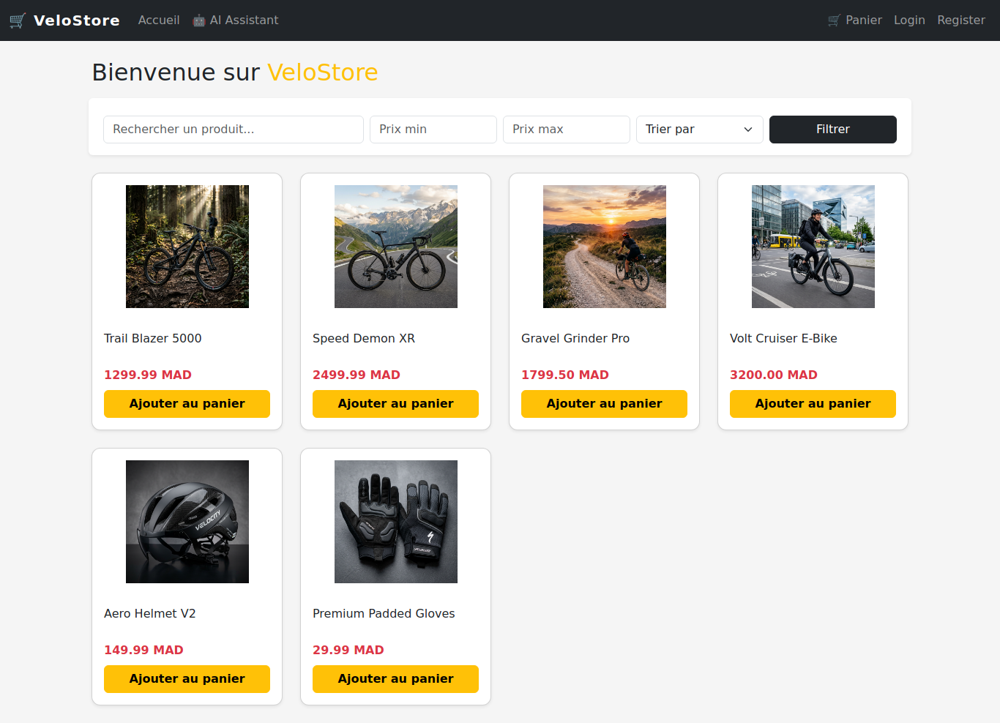
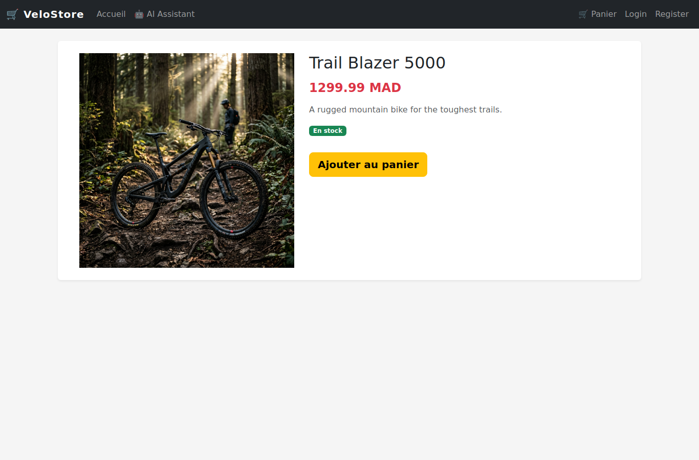
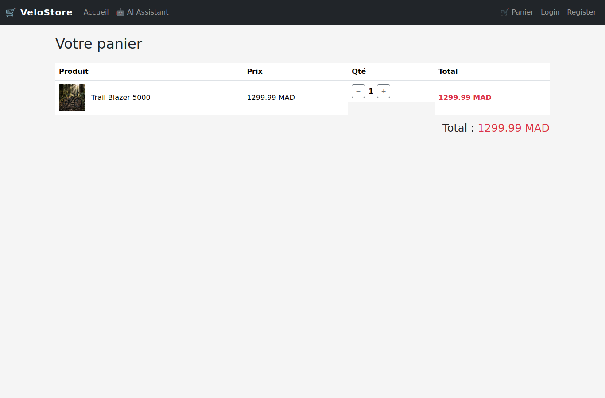
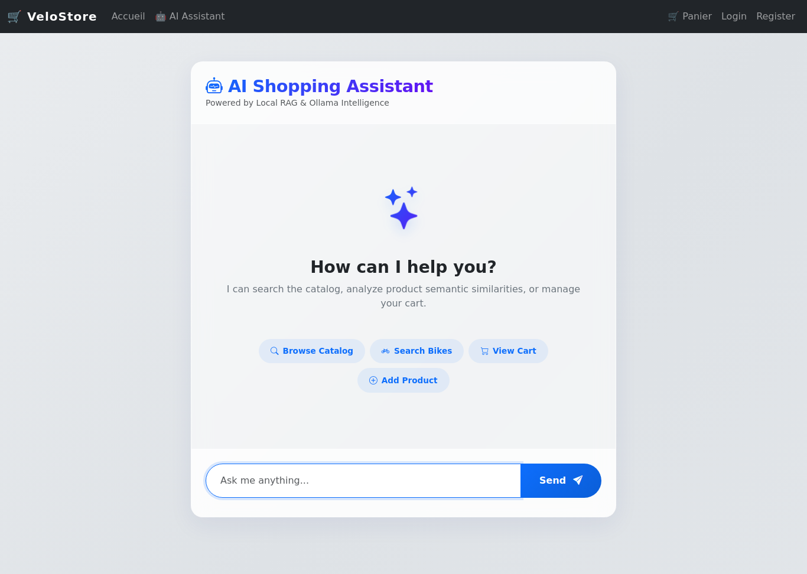
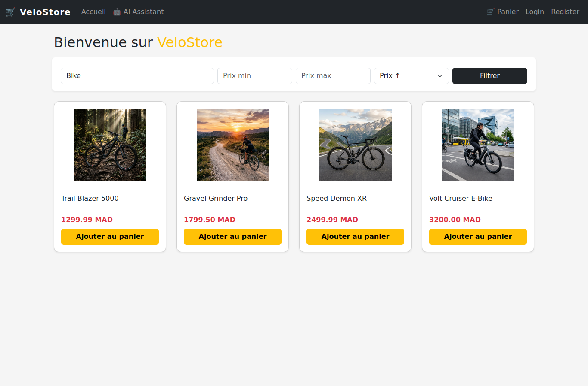
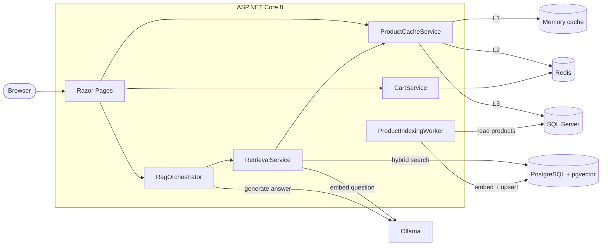

<div align="center">

# VeloStore

**A cycling e-commerce store built with ASP.NET Core 8, with a three-level cache and a fully local AI shopping assistant.**

[](https://github.com/abdellahBSK/VeloStore/actions/workflows/ci.yml)


[](LICENSE)



</div>

## Overview

VeloStore is a bike shop: customers browse and search a catalog, keep a cart as a guest or with an account, and ask an AI assistant questions such as *"Which bike is best for gravel under 2,000 MAD?"*.

Two parts of the project go beyond a standard CRUD app:

- **Caching in three levels.** Product reads go through an in-process memory cache, then Redis, then SQL Server. If Redis goes down, the store keeps working from memory and the database.
- **A retrieval-augmented (RAG) assistant that runs entirely on your machine.** Products are embedded with Ollama and stored in PostgreSQL with pgvector. Each question is answered by a local LLM, using only the products that a hybrid (vector + full-text) search returns. No data leaves your machine and there is no API bill.

The storefront UI is in French; the code and documentation are in English.

## Features

| Area | What it does |
| --- | --- |
| **Catalog** | Product list, details page, text search on name and description, price range filter, sorting |
| **Cart** | Works for guests and signed-in users, stored in Redis with sliding expiration; the guest cart is merged into the user's cart at sign-in |
| **Accounts** | ASP.NET Core Identity: strong password rules, account lockout after 5 failed attempts, unique emails |
| **AI assistant** | Chat page backed by RAG: Ollama `nomic-embed-text` for embeddings, `phi3:mini` for answers, pgvector hybrid search |
| **Resilience** | Redis failures fall back to the database; Ollama calls have timeouts, retries and a circuit breaker; a background worker indexes new products |
| **Operations** | `/health` endpoint, Docker Compose stack, GitHub Actions CI with unit tests and a browser smoke test |

## Screenshots

| Product details | Cart |
| --- | --- |
|  |  |
| **AI assistant** | **Search** |
|  |  |

The screenshots are captured automatically by the CI smoke test.

## Architecture



### Read path for products

1. **L1, memory cache.** Per server instance, 5 minutes for the product list. Served without any network call.
2. **L2, Redis.** Shared by all instances, 10 minutes. A hit also fills L1.
3. **L3, SQL Server.** The source of truth. A miss fills both cache layers.

Searches and filters always go to the database, so results are never stale. Cache lifetimes are set in the `CacheSettings` section of the configuration. More detail: [docs/CACHE_ANALYSIS.md](docs/CACHE_ANALYSIS.md) and [docs/REDIS_CACHING_GUIDE.md](docs/REDIS_CACHING_GUIDE.md).

### How the assistant answers a question

1. **Sanitize** the question: strip chat-template and role tokens, and limit it to 250 characters.
2. **Embed** it with `nomic-embed-text` (768 dimensions).
3. **Hybrid search** in pgvector: `0.7 × cosine similarity + 0.3 × full-text rank`, keeping the products above a relevance threshold (at most four).
4. **Generate** with `phi3:mini` at temperature 0.05, under a strict prompt that only allows answers from the retrieved products. If nothing matches, the assistant says so instead of guessing.

A background worker embeds products that are new or were indexed with an older embedding model. More detail: [docs/RAG.md](docs/RAG.md). The known limits of the keyword-based prompt sanitizer are analysed in [docs/PROMPT_SANITIZER_BYPASS.md](docs/PROMPT_SANITIZER_BYPASS.md).

## Getting started

### Option 1: Docker (recommended)

Requires Docker Desktop (or Docker Engine with Compose).

```bash
git clone https://github.com/abdellahBSK/VeloStore.git
cd VeloStore
docker compose up -d --build
```

Open **http://localhost:8080**. On first start the app applies the database migrations and seeds the catalog.

To also run the AI assistant, start the `ai` profile. The first run downloads about 2.5 GB of models:

```bash
docker compose --profile ai up -d --build
```

### Option 2: Run the app with `dotnet`

Requires the [.NET 8 SDK](https://dotnet.microsoft.com/download/dotnet/8.0). Start only the backing services in Docker, then run the app:

```bash
docker compose up -d sqlserver redis postgres      # add "ollama ollama-models --profile ai" for the assistant
dotnet run --project src/VeloStore
```

The app runs at http://localhost:5021. `appsettings.Development.json` already points to the Docker services. To use your own SQL Server instead, override the connection string with user secrets:

```bash
dotnet user-secrets set "ConnectionStrings:DefaultConnection" "<your connection string>" --project src/VeloStore
```

## Configuration

Every setting can be overridden with an environment variable, using `__` as the separator (for example `ConnectionStrings__Redis`).

| Key | Purpose | Default |
| --- | --- | --- |
| `ConnectionStrings:DefaultConnection` | SQL Server: catalog, users, carts | none (Development: Docker SQL Server) |
| `ConnectionStrings:Redis` | Redis: L2 cache, carts, sessions | none (Development: `localhost:6379`) |
| `ConnectionStrings:VelostoreAiConnection` | PostgreSQL with pgvector | none (Development: `localhost:15433`) |
| `Ollama:BaseUrl` | Ollama API | `http://localhost:11434` |
| `Ollama:ChatModel` / `Ollama:EmbeddingModel` | Models used by the assistant | `phi3:mini` / `nomic-embed-text` |
| `CacheSettings:MemoryCacheDurationMinutes` | L1 lifetime of the product list | `5` |
| `CacheSettings:HomePageCacheDurationMinutes` | L2 lifetime of the product list | `10` |
| `CacheSettings:ProductDetailsCacheDurationMinutes` | Lifetime of one product's details | `30` |
| `CacheSettings:CartExpirationHours` | Sliding expiration of carts and sessions | `6` |

## Tests

```bash
dotnet test
```

The unit tests in `tests/VeloStore.Tests` cover:

- **Cart:** guest carts across requests, merging at sign-in, quantities, separate guest and user carts.
- **Product cache:** memory → Redis → database fallback, invalidation, Redis outage, search and filters.
- **AI pipeline:** prompt sanitizing, relevance threshold and ranking, the orchestrator's behaviour when Ollama or retrieval fails, and the prompt context format.

On every pull request, CI also starts the full Docker stack and runs a [Playwright smoke test](.github/scripts/smoke-test.mjs) that browses the store, adds a product to a guest cart and checks it is still there on the next request.

## Project structure

```
VeloStore/
├── src/VeloStore/
│   ├── Application/        # RAG orchestration, retrieval, prompts, options
│   ├── Domain/             # Interfaces and entities for the AI pipeline
│   ├── Infrastructure/     # Ollama client, pgvector repository, indexing worker
│   ├── Services/           # Cart and product cache services
│   ├── Data/               # EF Core DbContext and seed data
│   ├── Models/             # EF Core entities
│   ├── ViewModels/         # Data passed to the pages
│   ├── Pages/              # Razor Pages (catalog, cart, assistant)
│   ├── Areas/Identity/     # Login, register, logout
│   └── Migrations/         # EF Core migrations
├── tests/VeloStore.Tests/  # xUnit unit tests
├── deploy/postgres/        # pgvector schema
├── docs/                   # Design notes and analyses
├── Dockerfile
└── docker-compose.yml
```

## Design decisions

- **Razor Pages instead of an SPA.** The store is mostly server-rendered content; Razor Pages keeps each page's logic next to its view and needs no separate frontend build.
- **Carts in Redis, not SQL Server.** Carts change often and expire. Redis handles that with sliding expiration and no clean-up jobs.
- **A separate PostgreSQL for vectors.** SQL Server 2022 has no vector index; pgvector provides HNSW indexes and full-text search in one query.
- **A local LLM.** Customer questions and catalog data stay on the server, and there is no per-request cost. The trade-off is answer quality and speed on modest hardware, which is why answers are short and the context is small.

## Roadmap

- [ ] Checkout and orders
- [ ] Admin pages for products, with cache invalidation and re-indexing on change
- [ ] Integration tests against real SQL Server and Redis (Testcontainers)
- [ ] Stronger prompt-injection defence (see the bypass analysis)
- [ ] Streamed assistant answers

## Author

**Abdellah Bouskri**, software engineering student, Morocco
GitHub: [@abdellahBSK](https://github.com/abdellahBSK)

Released under the [MIT License](LICENSE).
